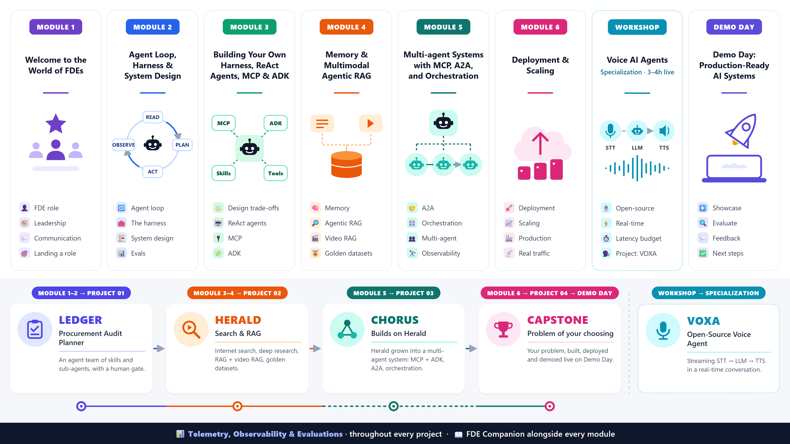
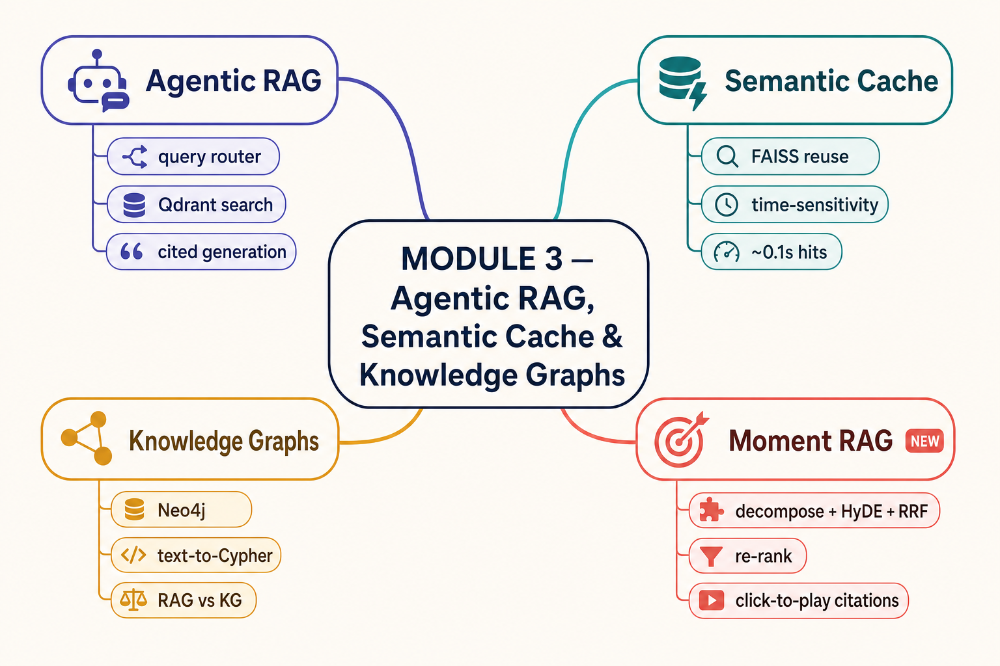

<div align="center">

# 🤖 Forward Deployed Engineering Bootcamp
### Build production AI systems, from first agent to deployed capstone

**Six weeks to become a forward deployed engineer: learn how harnesses work, build a search and RAG agent, grow it into a multi-agent system with evals throughout, then ship a capstone on a real problem of your choosing.**

[](https://maven.com/boring-bot/ai-system-design)
&nbsp;

&nbsp;

&nbsp;
[](https://companion.traversaal.ai)
&nbsp;
[](https://claude.com/claude-code)

[**FDE Bootcamp on Maven**](https://maven.com/boring-bot/ai-system-design) · [**Companion**](https://companion.traversaal.ai) · [**Curriculum**](#course-curriculum) · [**The four projects**](#the-four-projects) · [**What you'll build**](#what-youll-build) · [**Learn with Claude**](#learn-with-claude-ai-tutor)



**Cohort 2026-04 · starts Nov 14, 2026 · 7 live sessions · 4 projects · 1 specialization · closing with Demo Day**

</div>

---

Welcome to the official course repository for the **Forward Deployed Engineering Bootcamp** ([★ 4.9 from 87 ratings on Maven](https://maven.com/boring-bot/ai-system-design)): all the code, notebooks, exercises, and project specs used throughout the course.

Six modules teach the concepts; four projects make you ship them. A dedicated **Voice AI Agents** workshop adds a specialization, **telemetry, observability, and evaluations** run underneath every project from the first one on, and the course closes with **Demo Day**, where you demo your Capstone live. The **[FDE Companion](https://companion.traversaal.ai)** goes alongside every module.

> **Branches are cohort archives.** `main` is always the course as it is being taught now
> (currently cohort 2026-04). Every past cohort is frozen on its own branch and never moves again:
> [`2026-03`](https://github.com/hamzafarooq/multi-agent-course/tree/2026-03),
> [`2026-02`](https://github.com/hamzafarooq/multi-agent-course/tree/2026-02), and `2026-01` before it.
> Clone `main` unless you are deliberately looking at history.

## Why Forward Deployed Engineering?

Modern AI builders need more than model skills.

- **Roles are converging.** AI work now requires system design and production skills, not just prompts.
- **FDEs need AI depth.** Agents, RAG, voice, and orchestration are becoming the core of the job.
- **The model is only one piece.** Reliability, latency, cost, security, and scale decide whether it ships.
- **Industry needs end-to-end builders** who can sit with a client, understand the problem, design, build, and ship.

## By the end of this bootcamp you will be able to

- Work as an **FDE**: find the costly workflow, lead without authority, and communicate with clients.
- Master the **agent loop** and understand what a **harness** does, then build your own.
- Apply **system and product design** across frontend, backend, APIs, data, and deployment.
- Build **ReAct agents** and connect them to the world with **MCP** and **ADK**.
- Give agents **memory**, and engineer **multimodal agentic RAG** across text and video, measured against **golden datasets**.
- Design **multi-agent systems** with **A2A** and orchestration that stay reliable under real load.
- **Deploy and scale** agentic systems and keep them observable under real traffic.
- Build a **real-time voice agent** in the specialization workshop.

## Who this course is for

- **AI / ML engineers** ready to move from prototypes to production.
- **Software / full-stack engineers** building AI-native products and agents.
- **Forward deployed / solutions engineers** solving customer problems with AI.
- **Engineering & product leaders** making better architecture and scaling decisions.
- **Builders** who want to understand the complete system around AI.

## Quick Links

> 🧭 **New here? Read [`START_HERE.md`](START_HERE.md) first.** Ten minutes, once — how an assignment is structured, which files are written for you and which for your
> coding agent, what's yours to decide, and how to drive a build with Claude Code.

**Course modules** (in teaching order):

1. [Module 1: Welcome to the World of FDEs](#module-1-welcome-to-the-world-of-fdes)
2. [Module 2: Agent Loop, Harness & System Design](#module-2-agent-loop-harness--system-design)
3. [Module 3: Building Your Own Harness, ReAct Agents, MCP & ADK](#module-3-building-your-own-harness-react-agents-mcp--adk)
4. [Module 4: Memory & Multimodal Agentic RAG](#module-4-memory--multimodal-agentic-rag)
5. [Module 5: Multi-agent Systems with MCP, A2A, and Orchestration](#module-5-multi-agent-systems-with-mcp-a2a-and-orchestration)
6. [Module 6: Deployment & Scaling](#module-6-deployment--scaling)
7. [Specialization workshop: Voice AI Agents](#specialization-workshop-voice-ai-agents)
8. [Demo Day: showcase your Capstone](#demo-day-showcase-your-capstone)

**Also on this page:** [The FDE Companion](#the-fde-companion-before-day-one-and-throughout) · [The four projects](#the-four-projects) · [How to use this repo](#how-to-use-this-repo) · [What you'll build](#what-youll-build) · [Sprint Zero](#full-stack-projects) · [Starter Projects](#starter-projects) · [The quality bar](#the-quality-bar-how-work-is-judged-and-how-to-give-feedback) · [Start here](START_HERE.md) · [How to submit](SUBMISSION.md)

### 🗺️ Course at a glance

| # | Module | The big idea | Project |
|---|--------|--------------|---------|
| 1️⃣ | **Welcome to the World of FDEs** | What FDEs do, leading without authority, communication, landing the role | 📒 **Ledger** kicks off |
| 2️⃣ | **Agent Loop, Harness & System Design** | How agents reason and act, what a harness does, and evals and observability from day one | 📒 **Ledger**: skills, sub-agents, human gate |
| 3️⃣ | **Building Your Own Harness, ReAct Agents, MCP & ADK** | From Claude Code to your own harness, and the system design trade-offs | 📣 **Herald** kicks off |
| 4️⃣ | **Memory & Multimodal Agentic RAG** | Memory, and retrieval that reasons across text and video, measured against golden datasets | 📣 **Herald**: RAG, video RAG, golden datasets |
| 5️⃣ | **Multi-agent Systems with MCP, A2A, and Orchestration** | Coordinate agents, tools, and outside systems so multi-step workflows stay reliable | 🎼 **Chorus**: builds on Herald |
| 6️⃣ | **Deployment & Scaling** | Take agentic systems to production, scale them, keep them observable | 🏆 **Capstone** kicks off: a problem of your choosing |
| 🎙️ | **Voice AI Agents** (specialization workshop, 3–4h live) | Build an open-source voice agent end to end | 🎙️ **VOXA** |
| 🚀 | **Demo Day** | Show it, measure it, defend it | 🏆 **Capstone**, demoed live |

---

## The FDE Companion: before day one and throughout

The **[FDE Companion](https://companion.traversaal.ai)** is the reading that goes with the bootcamp, used for the whole course: short videos, readings, and step-by-step checklists for every module.

- **Before day one,** do everything that's open (about two hours) and set up your work environment, so you arrive ready to build.
- **During the course,** come back to the module you're in. New topics appear as the course reaches them, and the modules marked *coming soon* fill in. Each module below links its companion page.

Its hands-on steps run in [`fde-companion-kit/`](fde-companion-kit/README.md): open that folder in VS Code and type `/companion`, and Claude Code checks your setup and tells you what's next.

> The companion site numbers its modules 0–5; this README follows the syllabus, 1–6. Companion Module 0 is Module 1 here, and so on.

---

## The Four Projects

Concepts are taught in the modules; the projects are where you ship. Each is a real product built end to end and graded against a **measurable rubric plus a short video demo, not vibes**. Each project spec lands in its module folder as the course reaches it.

| # | Project | Modules | You build | Spec |
|---|---|---|---|---|
| 1 | 📒 **Ledger**: Procurement Audit Planner | 1–2 | An agent team built from skills and sub-agents, with a human gate before anything consequential happens | spec coming |
| 2 | 📣 **Herald**: Search & RAG | 3–4 | Internet search and deep research, RAG and video RAG, measured against golden datasets | spec coming |
| 3 | 🎼 **Chorus**: builds on Herald | 5 | Herald grown into a multi-agent system: MCP + ADK, A2A, and orchestration | spec coming |
| 4 | 🏆 **Capstone**: a problem of your choosing | 6 → Demo Day | Your own problem statement, built, deployed, and demoed live on Demo Day | spec coming |
| 🎙️ | **VOXA** (workshop project): open-source voice agent | Workshop | A streaming STT → LLM → TTS voice agent that holds a real-time conversation | [Voice Agent spec](FDE-01-assignments/Assignment_2_voice_agent/) |

**Telemetry, observability, and evaluations run throughout every project.** Every project ships an `eval/` folder with a `rubric.json` and an `eval.py` that scores your running deployment, captures evidence, and produces a **Product Evaluation** report you submit with a 60–90s demo. [See a sample scorecard →](FDE-01-assignments/Assignment_1_Live_Translate/README.md#sample-scorecard)

---

## How to Use This Repo

### Start here: understand the course in 15 minutes

1. **Read the outline above**, then the [course at a glance](#quick-links) table: six modules, a voice workshop, and four shipped projects.
2. **Open one module folder.** Module material lives at `modules/Module_N_Name/` and follows the same shape: a `README.md` that says what the module covers and what's inside, a `study-material/` folder with `lesson.md`, `key-concepts.md`, `exercises.md`, `quiz.md`, and `recap-and-preview.md`, and the notebooks, apps, and specs next to them. The folder names still carry the previous cohort's titles; the [curriculum](#course-curriculum) below maps each module of this cohort to the folders that hold its material. A good first stop is [Alex](modules/Module_1_Agent_Foundations_Harness_System_Design/Alex_Perplexity_Clone/README.md), a finished reference app you can clone and take apart.
3. **Let an agent walk you through it.** Open the repo in Claude Code and type `/start`, or point any other coding agent at [`AGENTS.md`](AGENTS.md). Either way you get a tutor that teaches one concept at a time and tracks you in `progress/learner-progress.md`. See [Learn with Claude](#learn-with-claude-ai-tutor).
4. **Read one project spec end to end** before touching code. The [LUMINA PRD](modules/Module_1_Agent_Foundations_Harness_System_Design/Assignment_1_Lumina/PRD.md) from the previous cohort shows the shape every project follows: a fixed API contract, a provided UI that is the acceptance test, an SLA you prove with a benchmark, and a rubric. This is a *reading* course first.
5. **Know how work gets judged** and how to give feedback that helps: [The quality bar](#the-quality-bar-how-work-is-judged-and-how-to-give-feedback). And how you submit: a Vercel link to your deployed app with an `/evals` sub page that proves itself. See [`SUBMISSION.md`](SUBMISSION.md).

### Layout

- Content is organized **module by module** under `modules/`, aligned with the live sessions and project milestones. New project specs ship inside their module folders; the previous cohort's specs, still used for VOXA and as reference material, live under `FDE-01-assignments/`. Ungraded practice apps live in `Starter_Projects/`, and the companion's hands-on steps in `fde-companion-kit/`.
- **Google Colab Pro** is the preferred environment for the notebooks. You can also **clone locally** and run them in Jupyter or your IDE.
- Most notebooks include their own dependencies via `!pip install`; where a module needs more, a `requirements.txt` sits alongside it.

### Learn with Claude (AI tutor)

This repo is also set up to be **read and used with [Claude](https://claude.com/claude-code)** as a personal tutor. Drop the folder into Claude Code (or upload it to Claude.ai) and Claude reads `CLAUDE.md` to act as a patient, interactive guide through the course, teaching one concept at a time, checking your understanding, and tracking your progress in `progress/learner-progress.md`.

**Get started:** open the folder in Claude Code and type `/start`, or paste *"Read CLAUDE.md and run the `/start` onboarding"* into Claude.ai. Claude will greet you, ask how you like to learn, and begin Module 1. Using Codex, Cursor, or another coding agent? [`AGENTS.md`](AGENTS.md) at the repo root carries the same tutor instructions.

**Slash commands**

- `/start`: onboard, pick a learning style and begin Module 1 (or the next one)
- `/progress`: see where you are, what's next, and any flagged weak spots

**Skills Claude auto-invokes** (in `.claude/skills/`): just ask in plain language:

| Skill | What it does | Try saying |
|-------|--------------|------------|
| `teach-module` | Runs an interactive lesson for a module, one concept at a time | *"Teach me module 4"* |
| `quiz-me` | Quizzes you and tracks weak spots (never reveals answers first) | *"Quiz me on RAG"* |
| `explain-eli5` | Re-explains a concept as simply as possible, with analogies | *"Explain isolated context like I'm five"* |
| `build-along` | Guides you through a hands-on exercise step by step | *"Let's do the build-along for module 2"* |
| `warmup` | A ~15-min pre-class refresher: recaps the last module, previews the next | *"I have class soon, warm me up for module 3"* |

### Clone locally (optional)

```bash
git clone https://github.com/hamzafarooq/multi-agent-course.git
cd multi-agent-course
python3 -m venv .venv
source .venv/bin/activate
```

### Clone via Claude Code chat

You can clone this repo directly from the Claude Code chat interface without leaving your conversation:

1. Open [Claude Code](https://claude.ai/code) in your browser (or launch `claude` in your terminal)
2. In the chat, type:
   ```
   Clone https://github.com/hamzafarooq/multi-agent-course.git and open it
   ```
3. Claude will clone the repo into a directory of your choice, set up the project, and open it, ready for you to start learning.

From there, type `/start` to begin the AI-guided onboarding.

### Recommended resource

To go deeper on building LLM applications, see the book
[**Build LLM Applications from Scratch**](https://www.manning.com/books/build-llm-applications-from-scratch).

---

## Course Curriculum

> Six modules across six weeks, plus a dedicated Voice AI Agents workshop: seven live sessions in all, closing with Demo Day. Every module ends with something you built yourself, and telemetry, observability, and evaluations run underneath every project.
>
> **Where the material lives.** This cohort's modules reuse material from folders named for the previous cohort. Each module below lists the folders that hold its material.

### Module 1: Welcome to the World of FDEs

What forward deployed engineers do, leading without authority, communication, landing the role, and how this course gets you there. Set up your work environment so you arrive ready to build.

**Key topics:** the FDE role · leadership · landing a role

**Material in this repo:**
- [FDE Companion](https://companion.traversaal.ai), Module 0 (what an FDE does, your FDE workbench, how LLMs work), with its hands-on steps in [`fde-companion-kit/`](fde-companion-kit/README.md)
- Optional reading on leading without authority: [Leading AI Systems Across Teams](modules/Module_6_Leading_AI_Systems_Across_Teams/README.md)

**🚀 Project kickoff: Ledger.** A procurement audit planner built by an agent team: skills, sub-agents, a human gate. It runs across Modules 1–2; its spec lands in the module folder as the course reaches it.

---

### Module 2: Agent Loop, Harness & System Design

How agents reason and act, what a harness does, AI system design, and evals and observability from day one. Build a ReAct agent from scratch, no framework.

**Key topics:** the agent loop · ReAct (Reasoning + Acting) · agent vs. workflow vs. chatbot · the harness (tools, context, permissions, memory) · components & responsibilities · scale up vs. scale out · evals and observability from day one

📖 **Companion:** [Module 1](https://companion.traversaal.ai/m1/)

**Material in this repo:** [`modules/Module_1_Agent_Foundations_Harness_System_Design/`](modules/Module_1_Agent_Foundations_Harness_System_Design/README.md) · [harness principles](modules/Module_1_Agent_Foundations_Harness_System_Design/reference/harness-principles.md)

**🔎 Reference app: Alex.** A finished Perplexity-style assistant you can clone and take apart. Four levels (LLM → chatbot → tool-using agent → RAG assistant), a debug panel that shows the exact API request behind every answer, and a keyword-vs-semantic Search Lab. Hosted at https://lumina-perplexity-clone.vercel.app (password shared in class).
[Open Alex →](modules/Module_1_Agent_Foundations_Harness_System_Design/Alex_Perplexity_Clone/README.md)

**📒 Project: Ledger** (continues). Skills, sub-agents, a human gate, and an agent team.

---

### Module 3: Building Your Own Harness, ReAct Agents, MCP & ADK

From Claude Code to your own harness: ReAct agents, skills and sub-agents, MCP and ADK, and the system design trade-offs between them.

**Key topics:** design trade-offs · ReAct agents · skills & sub-agents · isolated context windows · the orchestrator pattern · defining subagents in `.claude/agents/` · MCP (tools) · ADK (Google's agent framework)

📖 **Companion:** [Module 2](https://companion.traversaal.ai/m2/)

**Material in this repo:**
- [`modules/Module_2_Skills_Subagents_Product_Architecture/`](modules/Module_2_Skills_Subagents_Product_Architecture/README.md): skills, subagents, and the orchestrator pattern
- [ReAct agent + agentic RAG](modules/Module_4_Multi_Agent_Systems_Orchestration/Rag_react/) · [how skills work under the hood](modules/Module_4_Multi_Agent_Systems_Orchestration/how_skills_work_under_the_hood.ipynb) · [agent + subagent orchestrator starter](modules/Module_4_Multi_Agent_Systems_Orchestration/agent_subagent_orchestrator_starter.ipynb)
- [`MCP/`](MCP/): basic and SQLite MCP agent implementations

**📦 Featured project: [Sprint Zero](#full-stack-projects).** A multi-agent system that turns a product URL and three answers into six spec docs and a working full-stack app: the orchestrator + subagents pattern, end to end.

**🚀 Project kickoff: Herald.** Search & RAG: internet search and deep research, growing into RAG and video RAG in Module 4.

---

### Module 4: Memory & Multimodal Agentic RAG

Give agents memory, and retrieval that reasons across text and video, measured against golden datasets. Treat retrieval as a tool the agent *decides* to use, add a semantic cache for real latency/cost wins, contrast vector RAG with Knowledge Graphs, and push retrieval down to the exact *moment* in a video.

**Key topics:** memory · naive vs. agentic RAG · query routing & multi-hop retrieval · hybrid retrieval & RRF fusion · cross-encoder re-ranking · semantic caching · Knowledge Graphs · video RAG · golden datasets and the eval pyramid · guardrails (Llama Guard)

📖 **Companion:** [Module 3](https://companion.traversaal.ai/m3/) (coming soon)

**Material in this repo:** [`modules/Module_3_Production_Agentic_RAG_AI_Systems/`](modules/Module_3_Production_Agentic_RAG_AI_Systems/README.md). [Module at a glance](modules/Module_3_Production_Agentic_RAG_AI_Systems/README.md#module-3-at-a-glance): a one-screen map of its five folders.



**🎬 Featured project: Moment RAG.** Agentic RAG on *video*. Ask a complex question and get a streamed, **cited** answer where every citation pops up the source YouTube episode at the **exact moment**, with a synced transcript. Pipeline: self-query → decompose → hybrid retrieve (dense + BM25 + HyDE questions, RRF) → cross-encoder re-rank → cited synthesis.
[View documentation →](modules/Module_3_Production_Agentic_RAG_AI_Systems/Moment_RAG/README.md)

```bash
cd modules/Module_3_Production_Agentic_RAG_AI_Systems/Moment_RAG
pip install -r requirements.txt
cp .env.example .env      # add OPENAI_API_KEY
uvicorn app:app --reload  # open http://localhost:8000
```

**📊 Featured project: RAG vs. Knowledge Graph comparison framework.** A Streamlit app that objectively compares RAG and KG approaches with LLM-based evaluation and interactive graph visualizations.
[View documentation →](modules/Module_3_Production_Agentic_RAG_AI_Systems/Knowledge_Graphs/README.md)

```bash
cd modules/Module_3_Production_Agentic_RAG_AI_Systems/Knowledge_Graphs
python setup.py      # one-time setup
streamlit run app.py
```

**📏 Featured notebook: AI Evaluation Metrics.** A plain-English tour of the metrics used across every layer of an AI system: LLM quality & reasoning, RAG retrieval & generation, and full agent/multi-agent evaluation. No API keys, no model downloads, just the standard library doing the arithmetic so you can watch the numbers move.
[View documentation →](modules/Module_3_Production_Agentic_RAG_AI_Systems/Evaluation_and_Guardrails/README.md) · [](https://colab.research.google.com/github/hamzafarooq/multi-agent-course/blob/main/modules/Module_3_Production_Agentic_RAG_AI_Systems/Evaluation_and_Guardrails/AI_Eval_Metrics.ipynb)

**📣 Project: Herald** (continues). RAG + video RAG, measured against golden datasets.

---

### Module 5: Multi-agent Systems with MCP, A2A, and Orchestration

Coordinate agents, tools, and outside systems so multi-step workflows stay reliable under real load. When many agents beat one, and the more common case where they don't.

**Key topics:** one agent vs. many · topologies (orchestrator-worker, hierarchical, swarm, handoff) · **MCP** (tools), **A2A** (agent-to-agent), **ADK** (Google's framework) · shared state, memory & message passing · tracing and debugging multi-agent runs

📖 **Companion:** [Module 4](https://companion.traversaal.ai/m4/) (coming soon)

**Material in this repo:** [`modules/Module_4_Multi_Agent_Systems_Orchestration/`](modules/Module_4_Multi_Agent_Systems_Orchestration/README.md): how MCP, A2A, and ADK compose into one running system.

**🛎️ Featured project: Advanced Customer Support Agent.** A CLI support agent that ties all three protocols together: **ADK** defines the agents (Gemini 2.5 Flash), **A2A** runs the Security Judge and PII Masker as independent microservices, and **MCP Toolbox** exposes a PostgreSQL backend as tools. Wrapped in a multi-layer security pipeline (input sanitization → A2A security judge → DLP-based PII masking).
[View documentation →](modules/Module_4_Multi_Agent_Systems_Orchestration/advance-customer-support-agent-feature-A2A-MCP-ADK/README.md)

```bash
cd modules/Module_4_Multi_Agent_Systems_Orchestration/advance-customer-support-agent-feature-A2A-MCP-ADK
pip install -r requirements.txt
cp .env.example .env      # add Google Cloud + Mem0 keys
python -m cs_agent.a2a.run_servers   # start the A2A servers, then run the CLI
```

**🚀 Project: Chorus.** Builds on Herald: MCP + ADK, A2A, and orchestration.

---

### Module 6: Deployment & Scaling

Take agentic systems to production: deploy them, scale them, and keep them observable under real traffic. Why demos break in production, and what it takes to make them hold.

**Key topics:** deployment · scaling · production · observability under real traffic

📖 **Companion:** [Module 5](https://companion.traversaal.ai/m5/)

**Material in this repo:**
- [AI Infra on Kubernetes](FDE-01-assignments/Bonus_AI_Infra_K8s/README.md): self-hosted model serving (vLLM on GKE) with manifests, a demo, and evals
- [FDE Companion](https://companion.traversaal.ai), topic 5.1 *Why demos break in production*, with its client brief in [`fde-companion-kit/labs/m5-client-brief/`](fde-companion-kit/labs/m5-client-brief/)

**🚀 Project kickoff: Capstone.** A problem of your choosing: your own problem statement, built and deployed, then demoed live on [Demo Day](#demo-day-showcase-your-capstone).

---

### Specialization workshop: Voice AI Agents

A dedicated 3–4 hour live workshop where you build an open-source voice agent end to end, and survive real conversation.

**Key topics:** the voice stack (STT → LLM → TTS) · turn-taking & end-of-turn detection · latency budgeting, streaming & barge-in · tool calling inside a voice loop · cascade vs. speech-to-speech architectures · benchmarking voice agents on cost, latency, and capability

📖 **Companion:** Voice AI Agents workshop (coming soon)

**Material in this repo:** [`modules/Module_5_Voice_Agents_Conversational_Systems/`](modules/Module_5_Voice_Agents_Conversational_Systems/README.md)

**🎙️ Workshop project: VOXA.** An open-source voice agent: streaming STT → LLM → TTS with a knowledge router, evals, and telemetry, holding a real-time conversation.
[Voice Agent spec →](FDE-01-assignments/Assignment_2_voice_agent/)

---

### Demo Day: showcase your Capstone

**Showcase · Evaluate · Feedback · Next steps.** The course closes with Demo Day. You demo your **Capstone** live: a real problem of your choosing, deployed and doing real work. It is graded on the rubric, not the pitch: scored by its eval, critiqued on its trajectory, and defended on the numbers you declared before you built it.

[Demo Day brief →](modules/Module_7_Demo_Day/README.md)

---

## What You'll Build

This course goes beyond theory. Across six weeks, the workshop, and Demo Day you'll ship real, portfolio-ready artifacts:

| 🛠️ Artifact | What it proves |
|------------|----------------|
| 🔁 **ReAct agent** built from scratch | You understand the loop, not just a framework |
| 🤝 **Sprint Zero**: multi-agent app builder | You can orchestrate specialized subagents to a shared spec |
| 📒 **Ledger**: procurement audit planner | You can build an agent team from skills and sub-agents, with a human gate where it matters |
| 📣 **Herald**: search & RAG, with 🎬 **Moment RAG** as the video reference | Retrieval reasons across the web, documents, and video, and is measured against golden datasets |
| 🎼 **Chorus**: Herald as a multi-agent system | You can coordinate many agents over real protocols (MCP · ADK · A2A) |
| 🛎️ **Multi-agent support system** (MCP · A2A · ADK) | You can wire the protocol layer end to end and secure it |
| ✅ **Evaluation + telemetry, in every project** | You ship with measurable quality and observability |
| 🎙️ **VOXA**: real-time voice agent | You can budget latency and survive barge-in |
| 🏆 **Capstone**: your problem, deployed and demoed live on Demo Day | You can take a real problem from statement to production, and defend it on the numbers |

---

## Full Stack Projects

End-to-end, build-along projects that tie the course concepts together.

### 🚀 Sprint Zero: a multi-agent product team in your terminal

> **Point it at a product. Answer three questions. Get back a complete spec set and a working app.**

A Claude Code kit that runs a full sub-agent product team on your laptop: scoping, research, six spec docs, parallel engineering, and QA, all driven from one command. Featured in Module 3, and a working reference for the orchestrator + subagents pattern.

```
/sprint-zero https://twenty.com  →  📋 specs  →  🤝 parallel build  →  ✅ QA  →  🟢 running app
```

- ⚙️ **Configurable**: `web-app` / `api-service` / `cli-tool` · `node-react` / `nextjs` / `python-react`
- 🔌 **Zero-setup default**: SQLite + local auth, runs straight after clone (no account, no keys)
- ⏱️ **~10–20 min** end-to-end for an MVP

[](Full_Stack_Projects/Sprint_Zero)

Want to see a finished run before you start one? [`examples/ghost-lite`](Full_Stack_Projects/Sprint_Zero/examples/ghost-lite/) is a real Sprint Zero run against Ghost, with an added "Ask me" box that answers questions from the seeded blog posts, committed exactly as the agents produced it.

Built by [Yousuf Alvi](https://github.com/yousuf-alvi) and [Hamza Farooq](https://www.linkedin.com/in/hamzafarooq/).

---

## Starter Projects

Nine small, complete apps you can clone, run, break, and rebuild. Imported from
[claude-code-starter](https://github.com/hamzafarooq/claude-code-starter) (MIT). Ungraded. They exist so you
have working code to read alongside the modules and something real to point Claude Code at. Each folder is
self-contained: read its README, copy `.env.example` to `.env`, run it. None ship secrets.

| Project | What it does | Pairs with |
|---------|-------------|------------|
| [skill-sub-multi-agent](Starter_Projects/skill-sub-multi-agent/) | Interactive 4-level visualization of how skills, sub-agents, and multi-agent pipelines work (Next.js) | Module 3 |
| [research-frontend](Starter_Projects/research-frontend/) | Chat UI that teaches LLM modes one switch at a time: tools, memory, RAG, long-term storage | Modules 2, 4 |
| [full-stack-demo](Starter_Projects/full-stack-demo/) | Visual explainer of how a frontend, a backend, and an AI backend talk to each other | Module 2 |
| [competitor-research-agent](Starter_Projects/competitor-research-agent/) | End-to-end competitor research using sub-agents (pricing-fetcher + review-miner) | Module 3 |
| [research-agent](Starter_Projects/research-agent/) | Claude Code agent for deep competitive-landscape research with MCP | Module 3 |
| [meetingmemo](Starter_Projects/meetingmemo/) | Turns raw meeting notes into a structured standup update (Next.js + Anthropic API) | Module 2 |
| [meeting-notes-summarizer](Starter_Projects/meeting-notes-summarizer/) | Summarizes meeting notes into action items (Node.js + Express) | Module 2 |
| [prd-generator](Starter_Projects/prd-generator/) | Single-page PRD generator | Module 3 |
| [royal-pop-website](Starter_Projects/royal-pop-website/) | Scroll-driven product landing page built from a 15-second video (GSAP, Lenis, canvas frame playback) | Module 3 / Capstone |

Also worth a look, hosted elsewhere: [word-humanizer](https://github.com/hamzafarooq/word-humanizer/) ·
[seo-writer](https://github.com/hamzafarooq/seo-writer) · [linkedin-growth](https://github.com/hamzafarooq/linkedin-growth).
The previous cohorts' graded FDE projects live in [`FDE-01-assignments/`](FDE-01-assignments/README.md).

---

## The Quality Bar: how work is judged, and how to give feedback

Everything in this repo, a module, a project submission, a pull request, is held to one standard, and it is the same standard your agents will be held to in production. If you review someone's work here, or file feedback on the repo itself, use it.

### The four laws

1. **A thing that ran is not a thing that worked.** A notebook that finished, an eval that passed, a demo that streamed an answer: each proves the process did not crash. Correctness is proven separately, against numbers.
2. **Assert from declared numbers, never from detection.** Every gating threshold is written down *before* the run (latency, cost, recall, grounding) and checked by arithmetic against a run log. Asking a model whether the output was good is detection. An LLM judge may *report* on tone or helpfulness; it may never *block*.
3. **Every rule cites the failure that created it.** A rule with no incident behind it is an opinion. Rules in this course carry IDs (`A1` tool errors surface, `A2` the loop finished rather than hit a cap, `R2` forbidden tools were not called, `E2` declared eval thresholds met, `B1`–`B3` token, latency, and cost budgets, `P1` a human read the trajectory) and each cites the real incident that made it a rule.
4. **Gates run in order, and each one blocks.** Static checks, then the declared contract, then a smoke run, then the trajectory, then the eval, then a human. Cheap and deterministic first; expensive and human last. Nothing downstream runs on upstream garbage.

The [LUMINA spec, section 13](modules/Module_1_Agent_Foundations_Harness_System_Design/Assignment_1_Lumina/SPEC.md#13--quality-bar-how-done-is-proven) (from the previous cohort) is the worked example: the declared `expectations.json`, the run-log shape, the six gates, and the rubric rows mapped to rule IDs.

### How to give feedback that helps

Whether you are reviewing a classmate's capstone or opening an issue on this repo:

- **Read the trajectory, not the answer.** Before you say a project works, read one complete *successful* run and one complete *failing* run, every step. If you cannot produce a failing run, you do not understand the failure surface yet. Say which two runs you read.
- **Cite a rule ID, then the evidence.** "`A1`: the fetch on step 3 failed and returned an empty string the model read as a normal result" is a better review than a paragraph. It points at the precedent and tells the author exactly what to fix.
- **Bring the number, not the adjective.** "Slow" is a vibe. "p95 6.4 s against a declared 12 s budget, but 3 of 30 runs hit the 90 s cap" is feedback.
- **When you hit a failure the rules do not cover, write the rule.** One executable sentence, the real incident as its precedent (date, what broke, what it cost), and a self-check question a reviewer can answer out loud. That is the highest-value contribution you can make to this repo, because it is the actual job. Never invent a precedent to make a rule look grounded; a lessons file full of fiction is worse than an empty one.
- **For the repo itself:** file issues the same way. Which module, which file, what you expected, what happened, and which of the four laws it violates. A broken link or a stale path is a `T` (teaching quality) finding; say so.

### Before you claim anything is done

- [ ] Every gate passes, or each failure is waived in writing with a reason.
- [ ] You read one full successful trajectory and one full failing trajectory.
- [ ] Budget numbers were checked against what was declared, not eyeballed.
- [ ] Nothing that must not break is verified by a model's opinion.
- [ ] Any new failure found is now a rule, with its precedent.
- [ ] The precedents you wrote are true.

That last box is the whole system.

---

## About the Course

**[Forward Deployed Engineering Bootcamp](https://maven.com/boring-bot/ai-system-design)** on Maven: ⭐ 4.9 from 87 ratings.

**Instructor:** [Hamza Farooq](https://www.linkedin.com/in/hamzafarooq/): CEO & Founder, [Traversaal.ai](https://traversaal.ai) · Ex-Google & Walmart Labs · Adjunct Professor, UCLA & UMN

A hands-on, build-every-week bootcamp for engineers who already write Python and have touched LLM APIs. Six modules and a Voice AI Agents workshop across seven live sessions, closing with Demo Day, with the [FDE Companion](https://companion.traversaal.ai) alongside; you leave with four shipped projects, a specialization, and the **judgment** that separates engineers who ship agents from engineers who follow tutorials.

---

*Created by [boring-bot](https://maven.com/boring-bot). Building the future of AI, one agent at a time.*
